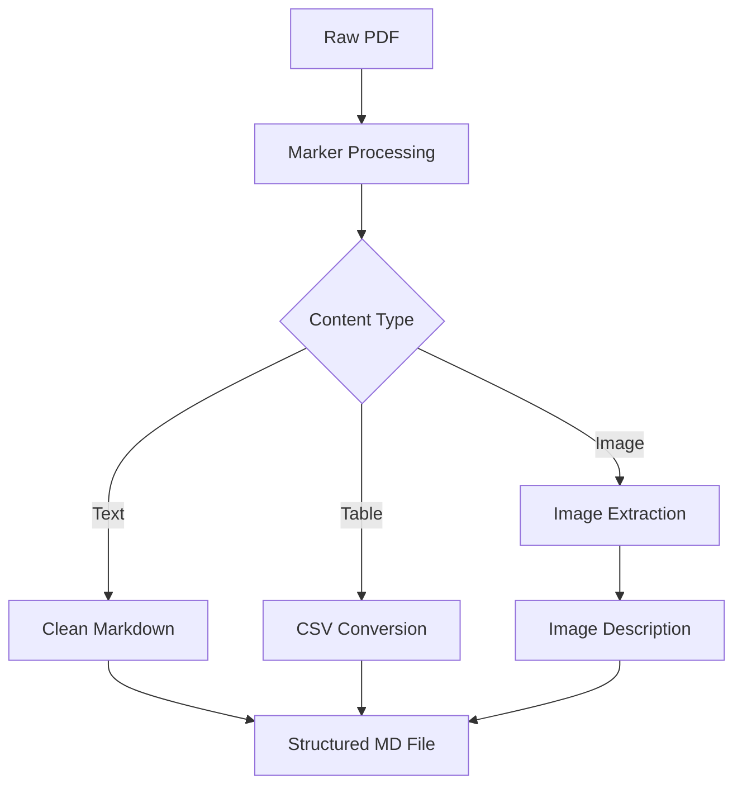

# Financial RAG (Retrieval-Augmented Generation) Bot
[App Link](https://dockernew-financeragbot.streamlit.app/)
## Project Overview
A sophisticated question-answering system for financial documents that:
- Processes PDF reports with tables/images into searchable markdown
- Generates AI-powered insights using Google Gemini
- Provides source-verified answers with citations

##  Technologies Used

| Component          | Technologies                                                                 |
|--------------------|------------------------------------------------------------------------------|
| **Frontend**       | Streamlit, Requests                                                          |
| **Backend**        | FastAPI, Uvicorn, LangChain                                                  |
| **NLP/ML**         | Google Gemini Pro/1.5-Pro, FAISS                                             |
| **Vector Storage** | FAISS (Facebook AI Similarity Search)                                        |
| **PDF Processing** | Marker (Modified for financial docs)                                         |
| **Infrastructure** | Heroku (Backend), Streamlit Community Cloud (Frontend)                       |

##  Document Preprocessing Methodology

### 1. **PDF Parsing & Structure Extraction**


### 2. ***Image-to-Text Conversion***

Gemini Pro Vision Prompt:
IMAGE_PROMPT = """Analyze financial visualization:
1. Type: [chart/graph/table]
2. Title/Labels: [axes/legend]
3. Key Insights: [trends/comparisons]
4. Numerical Data: [key figures]
5. Interpretation: [financial implications]"""


## Installation & Setup

### Prerequisites
- Python 3.10+
- Google API Key ([Get Key](https://ai.google.dev))
- Heroku CLI ([Install Guide](https://devcenter.heroku.com/articles/heroku-cli))

### Local Development
1. **Clone Repository**
   ```bash
   git clone https://github.com/lightshinichi/finance-rag-bot.git
   cd finance-rag-bot 

2 . **Install Dependencies**

```bash
pip install -r requirements.txt
 ```

3. **Environment setup**
```bash
echo "GOOGLE_API_KEY=your_api_key" > .env
echo "BACKEND_URL=http://localhost:8000" >> .env
```

4. **Start services**
```bash
# Backend (FastAPI)
uvicorn app.main:app --reload --port 8000
 
# Frontend (Streamlit) - New Terminal
streamlit run frontend/app.py
```
### **Deployment**
**Backend (Heroku)**

```bash
heroku create your-finance-rag-bot
heroku config:set \
  GOOGLE_API_KEY=your_key \
  PORT=8000 \
  MD_STORAGE_DIR=/app/stored_md_files \
  FAISS_INDEX_DIR=/app/faiss_index

heroku container:push web --recursive
heroku container:release web
```

**Frontend (Streamlit Cloud)**

Connect your GitHub repository
Set secrets in Settings -> Secrets:
```bash
[env_vars]
BACKEND_URL = "https://your-finance-rag-bot.herokuapp.com"
```
## Usage Guide

### 1. Document Processing

**Processing Demo**

- Upload PDFs via the `/stored_md_files` directory.
- Click **"Start Processing"** in the web interface.

The system will:
- Convert PDFs to structured markdown.
- Build a search index.

## # Directory Structure

```plaintext
finance-rag-bot/
├── app/                  # FastAPI Backend
│   ├── main.py           # Core API logic( Backend)
│   ├── stored_md_files/  # Processed documents
│   └── faiss_index/      # Vector embeddings( Will get created)
├── frontend/             # Streamlit Interface
│   ├── frontend.py            # Frontend
│   └── requirements_frontend/ # Requirements for frontend
├── Dockerfile            # Container config
└── requirements.txt      # # Requirements for backend
```

   
